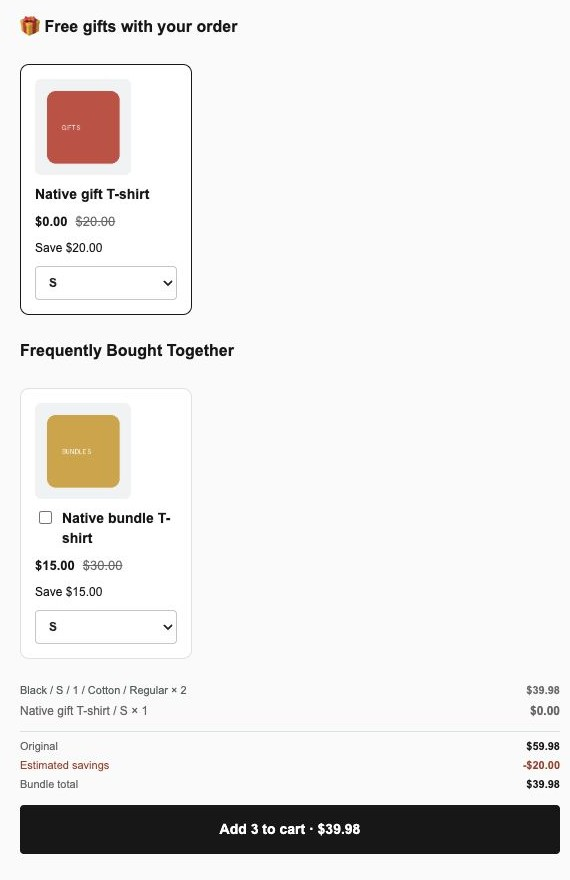
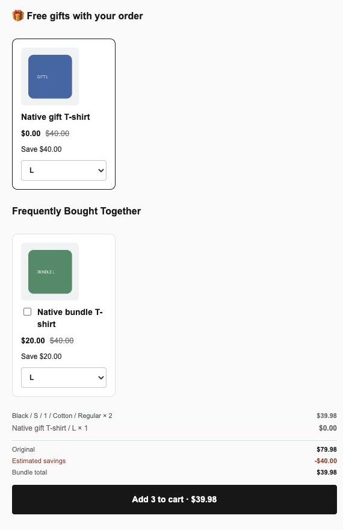
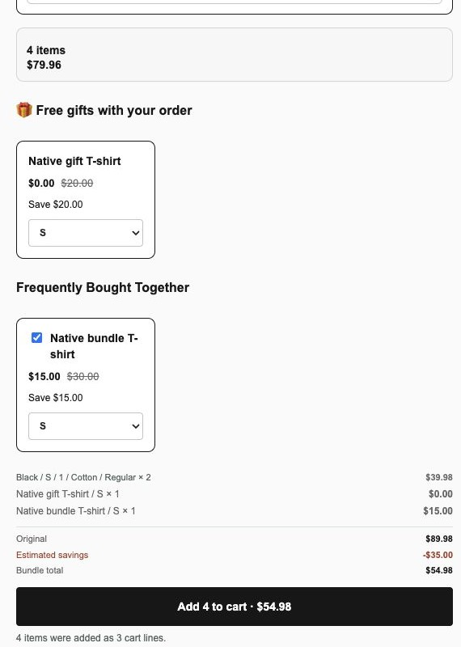

# 测试app-block加购及款式图片修复

本批仅修改 `/Users/SL/Desktop/多件折扣-测试环境/duojianzhekou-test`。
合并此前未推送的[OS2.1目录作用域修复](2026-11-26-test-os21-native-offer-scope.md)进行审核。
该旧审计中的文件范围和提交建议只描述当时的目录修复；本文件列出当前完整批次。

## 加购问题

`show` 和 `roleVisibility` 都描述购物车行属性的显示范围。活动、角色和关联上下文
属于隐藏内部属性，只需 `roleVisibility: none`。旧实现同时发送两个参数，触发用户报告的
`show and roleVisibility cannot be used as input parameters at the same time`。
现请求不再带show，响应按有效可见范围比较，以兼容平台回填show默认值。
不同可见范围、非法值、角色、活动、款式、附加属性和数量差异仍不能确认成功。

移除独立 `qb-check-cart qb-offer-select` 按钮。正常加购使用原按钮；结果不确定时，
同一按钮显示已有翻译Check cart并只读取购物车。持久事务保留，确认期间禁用，
重复点击、视口重渲染、活动修订或重新挂载均不会重新POST。

参考：[SHOPLINE Add to cart](https://developer.shopline.com/docs/ajax-api/cart/add-to-cart.md)。

## 款式图片问题

原共享运行时已有下拉change与重新渲染链路；检查和回归复现的缺陷是：

- `//cdn…` 协议相对图片地址被旧正则过滤，选中此类款式后没有图片节点。
- 只读取款式图，没有读取商品主图；选中没有独立图片的款式时卡片无图。

两代模板现在通过原生 `featured_image | image_url`／`image_url featured_image` 输出
商品主图。JS规范化HTTP(S)、协议相对URL及原有图片data URL，拒绝其他协议或无效URL。
每次渲染优先使用当前选中款式图，无图时回退本商品主图；不使用未选中的其他款式图，
不改变 `showImage: false` 配置，不新增商品API或Storefront Token。

参考：[OS2.1 image_url](https://developer.shopline.com/docs/handlebars/helpers/media/image-url.md)、
[OS3 image_url](https://developer.shopline.com/docs/sline/filter/image-url.md)、
[Variant image](https://developer.shopline.com/docs/handlebars/objects/variant.md)。

当前用户预览页只读检查仍无 `data-offer-variant` 节点，故不能据此确认该具体店铺的
款式图地址形态；需要先上传本批目录／图片修复再做真实SSR及图片切换验收。

## 验证结果

- 加购相关回归修改前4项失败，修复后通过；两项图片回归及实际OS2.1模板主图断言
  修改前分别失败，修复后通过。
- 定向71/71：offers、offer-card-presentation、os21、cart-refresh、compatibility-sync。
- 全主题151/152；失败项 `unchanged default desktop and mobile configuration renders a usable widget`
  断言默认间距8px，实际10px。前批已在ce738ec复现，见
  [历史验证记录](2026-11-25-gifts-bundles-local-integration.md)，本批未改默认间距。
- OS3模板通过主题技能的validate-syntax检查；OS2.1通过实际Handlebars编译与挂载测试；
  共享核心／兼容资源同步检查及git diff检查通过。
- Chrome本地真实按钮点击：正常请求确认4件／3行；模拟503后原按钮Check cart
  只读确认5件／2行。后者1次POST、3次GET；请求所有属性roleVisibility为none且无show。
- Chrome本地下拉切换：赠品S红图切到L蓝色商品主图，捆绑S黄图切到L绿色款式图；
  两张图片均complete且naturalWidth=160，款式与金额同时更新。
- 正式目录725文件哈希和Git状态不变；测试8项身份／凭据与HEAD中的Worker配置不变。

上述浏览器商品、图片和购物车来自本地合成夹具，无真实购物车写入。
OS3平台渲染、实际OS2.1 SSR、真实加购及结账仍待上传测试扩展后验证。

初始款式与切换后截图：

## 完整待审批文件

| 类型 | 文件 |
| --- | --- |
| 共享运行时 | `scripts/theme-offer-runtime.js` |
| 主运行时及生成片段 | `theme-app-extension/public/app-block.js` |
| 兼容生成资源 | `theme-app-extension/compatibility/assets/app-block.js` |
| 两代原生模板 | `theme-app-extension/blocks/app-block.html`、`theme-app-extension/compatibility/blocks/app-block.html` |
| 测试及夹具 | `tests/theme-app-extension/offers.test.mjs`、`tests/theme-app-extension/offer-card-presentation.test.mjs`、`tests/theme-app-extension/helpers/os21-fixture.mjs` |
| 进度 | `docs/APP_PROGRESS.md` |
| 新增审计 | `docs/audits/2026-11-26-test-os21-native-offer-scope.md`、`docs/audits/2026-11-26-test-cart-and-offer-images.md` |
| 新增截图 | `docs/local/native-offer-root-scope/reference-empty-offer.jpg`、`docs/local/native-offer-root-scope/local-native-offers.jpg`、`docs/local/cart-and-offer-images/images-first.jpg`、`docs/local/cart-and-offer-images/images-second.jpg`、`docs/local/cart-and-offer-images/local-added.jpg` |

9项修改、7项新增，无删除。无CSS、Worker、Function、身份／凭据配置变更。

目标Git：`https://github.com/TouchFish-Good/Kaching-Bundles-App-Upsells-Test.git`。
分支：`codex/gifts-bundles-test`。
拟提交：`fix(test): repair native offer catalog, cart properties and variant images`。

尚未提交、推送、部署或上传主题扩展；等待用户对本批明确授权。
