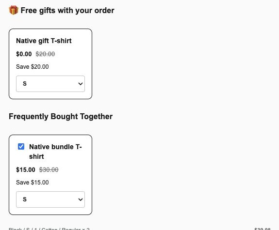

# OS2.1 app-block 原生商品目录为空

## 线上取证

用户提供测试店铺商品 `66666` 的预览链接及活动接口响应。Chrome 实际访问确认：

- 页面使用 OS2.1，主商品 ID 为 `16077565428920059189863770`。
- 测试 Worker 的公开活动接口返回200、协议版本2、赠品规则、索引摘要及
  `functionVerified: true`，活动规则已到达浏览器。
- 通过 Network 捕获服务器原始 HTML，`data-offer-native-catalog` 存在，
  但其中 `data-offer-entry` 和 `data-offer-product` 均为0；赠品显示两处 `Unavailable`。
- 浏览器未记录相关 JS 错误。该结果说明主题原生目录生成失败，不能解释为商品缺货。

Sparrow daemon 可启动但没有连接的扩展会话，未通过其执行诊断脚本；改用浏览器
只读取证。仅刷新商品预览页，没有保存商家活动、修改主题设置或操作购物车。

## 本地修复

OS2.1 模板在嵌套 `each` 内赋值，却从 `@root` 读取范围标记、去重集合、
计数及商品变量。旧测试夹具强制所有 `assign` 都写到根对象，掩盖了对作用域的依赖。
按当前上下文执行赋值的夹具可复现相同的空目录；模板在活动与商品两层中显式
`with @root` 后，通过同一根对象读写共享状态，保留词法块参数 `entry`／`ref`。

继续使用 `get ref.handle @root.all_products` 获取原生商品；不添加 Storefront
Token、商品代理或价格／库存猜测。保留范围／排除校验、优先级、去重、20个句柄上限、
原生款式读取及客户端摘要／白名单／币种／Function校验。

SHOPLINE主题技能检索并读取 `assign` 与 `contains` 文档；文档没有明确说明嵌套
`assign` 是否提升到根作用域，因此本次修复避免依赖这种提升行为。实际平台修复效果
仍须在上传测试扩展后回读SSR并验证，不将本地夹具当作平台实现证据。

## 验证

- 修改夹具后、修复模板前：目录预加载与商品渲染两项回归失败，未调用商品查找。
- 修复后：offers、offer-card-presentation、compatibility-sync、os21共51项通过。
  新增回归实际编译模板，再挂载共享前台运行时，确认赠品标题、原价、自动纳入及缺货款式隐藏。
- Chrome本地夹具验证：赠品 `$0.00 / $20.00 / Save $20.00`，捆绑
  `$15.00 / $30.00 / Save $15.00`；捆绑真实checkbox勾选／取消、赠品自动纳入，
  两类商品均只展示可售款式，没有横向溢出。没有点击加购。
- 模板通过实际Handlebars编译；主题共享核心及两代资源同步检查、diff检查通过。
- 正式725文件哈希和Git状态不变，测试其余8项身份／凭据与当前Worker配置不变。

截图已裁剪到相关组件，避免保留店铺密码提示；参考来自真实测试店铺，修复后截图
来自本地构造数据，不是平台上传后的验收：

## 本批文件与发布状态

- 修改 `theme-app-extension/compatibility/blocks/app-block.html`。
- 修改 `tests/theme-app-extension/helpers/os21-fixture.mjs`、`tests/theme-app-extension/offers.test.mjs`。
- 修改 `docs/APP_PROGRESS.md`，新增本审计与上述2张截图；无删除。
- 未修改OS3模板、运行时JS/CSS、Worker、Function或身份配置；尚未推送／上传主题。
- 目标Git：`https://github.com/TouchFish-Good/Kaching-Bundles-App-Upsells-Test.git`，
  分支 `codex/gifts-bundles-test`。
- 拟提交：`fix(test): bind OS2.1 offer catalog assignments to root scope`。
