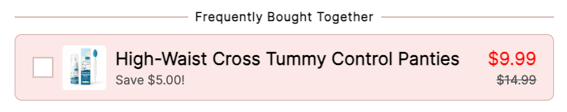
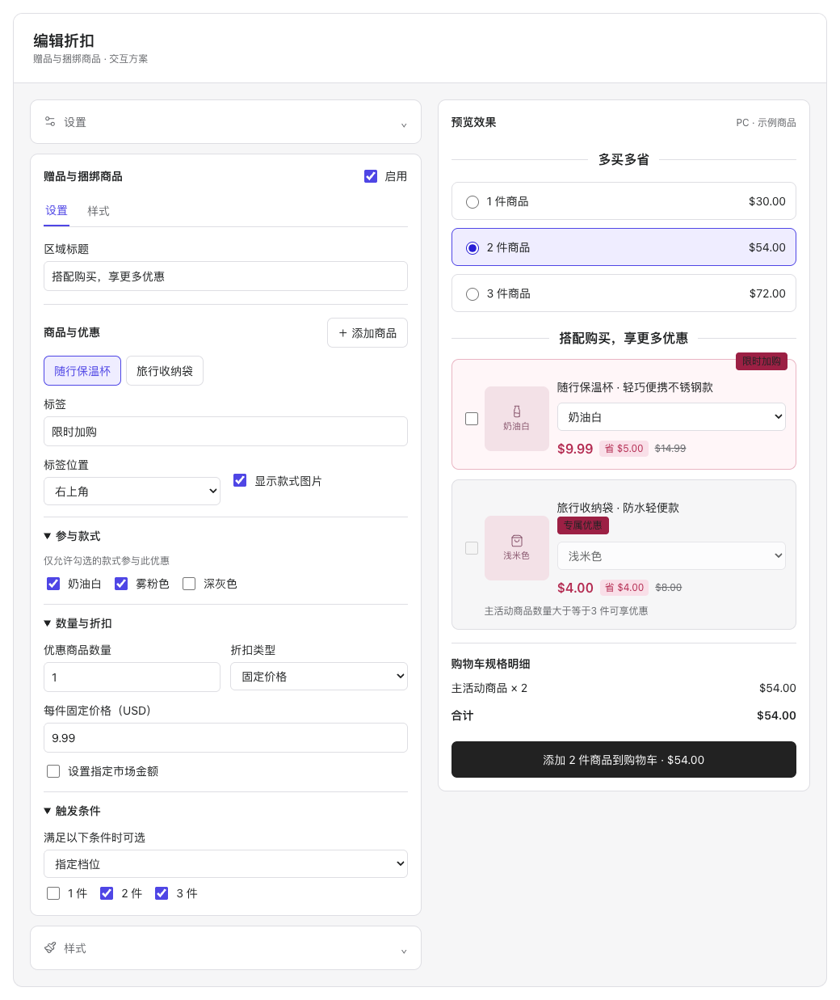

# 赠品与捆绑商品设计：编辑器、公共接口、App-block 与 Discount Function

日期：2026-11-24。状态：设计记录与实施建议，未实现、未部署、未完成实店验收。

> 历史设计：测试环境后续需求以 [2026-11-25 双模块设计](2026-11-25-test-gifts-bundles-design.md) 为准。新稿记录「设置 → 样式 → 赠品 → 捆绑商品」、两个模块同时生效、赠品达标全部自动加入且不可取消/捆绑支持多选、切档自动更新纳入集合、按合格主商品分别计算额度/不足上限仍优惠、异常单选按实际减免择优、桌面三列/手机单列和单行轮播；本页旧建议不再作为上述规则的实施依据。

本次仅更新设计文档及参考图片，不修改 Worker、Web、主题组件、Discount Function、配置或数据库。本文中的新增接口、JSON 字段、组件名均为拟议的应用内部协议，不是 SHOPLINE 新增的原生 API 或字段。不能根据本文将功能标为已支持。

## 1. 目标、已确认范围与建议的边界

在已有多件优惠活动中，为买家提供满足条件后可选择的赠品或优惠加购商品。保留现有主商品档位、指定商品优先于指定分类、订阅与排期规则，不把不同主商品合并计数。

用户明确提出的要求：

- 创建／编辑折扣时，在现有「设置」与「样式」之间增加赠品／捆绑商品板块，内部为「设置｜样式」，默认打开「设置」。建议板块名称为「赠品与捆绑商品」。
- 每个活动支持多个商品，每个商品分别设置参与款式、数量、优惠与触发条件。
- 支持区域标题、商品标签、标签位置（右上角／商品标题下面）、显示选中款式图片的开关。
- 优惠类型：每件固定减免、每件固定价格、百分比折扣；前两者支持指定市场金额。
- 触发条件：指定一个／多个档位，或主活动商品数量大于、大于等于、等于指定数量。
- 多款式使用现有档位下拉框样式；勾选商品后，现有购物车规格明细与合计同步展示该商品。
- 图片大小、图片圆角，以及区域标题、商品标题、标签、折扣价、原售价、优惠金额的颜色、字号、字重可配置。
- 多商品展示支持一行一列、一行两列、一行三列；PC／移动端分别配置，窄容器的降列与卡片细节按第3.4节建议实现。
- 未解锁商品内容透明度为 0.5，显示锁；点击对应商品时，切换至满足条件的档位以解锁。
- 需要考虑多个商品同时满足条件时，能否限制只让一个商品享受捆绑优惠。
- 兼容 OS2.1 与 OS3.0；本次只写设计，不能启动实现。

以下为建议，保留为实施前确认项，不冒充用户已确认的规则：

1. 活动级「捆绑商品选择方式」提供 `multiple`（可选多个）与 `single`（最多一个），建议默认 `multiple`。单选仍使用可取消的勾选框，选择 B 后取消 A。
2. `quantity` 是所选商品一次享受优惠的固定件数，不按主商品数量倍增；数量大于 1 时，按件分别选择款式。
3. 额度为每活动、每购物车一次（`quotaScope: campaign_cart`），并非每条行、每个新建分组或每次点击加购一次。
4. 点击锁定商品只切换主商品档位，不自动勾选收费或免费的赠品。条件不再满足时取消本组件中的选择。
5. 异常购物车同时出现多个单选赠品时，以配置中的 `displayOrder`、再以稳定 `giftRuleId` 排序，确定一个符合条件的规则享受优惠，其余不享受该赠品优惠。正常界面始终由买家选择，不能偷偷替换为优惠金额最大的商品。
6. 主商品和赠品的同一实际购买件数不能同时充当触发数量与赠品优惠数量；同商品、跨活动交集需要全局分配，不能仅通过客户端角色标记解决。

上述选择的取舍见第 13 节；实现前需明确确认。

## 2. 当前代码基线与需要改变的边界

| 已有文件／能力 | 当前行为 | 未来扩展 |
| --- | --- | --- |
| `web/src/prototype/CampaignEditor.tsx` | 折叠配置面板、SaveBar、主商品预览 | 插入新面板，接入现有草稿、校验、创建／更新，不增加独立保存按钮 |
| `worker/src/domain/campaign.ts` | 活动、档位、Widget 桌面／移动配置 | 增加可选赠品配置，旧活动缺失时视为关闭 |
| `worker/src/routes/storefront.ts` | GET／表单 POST `/public/quantity-breaks/campaign`，输出 `{ campaign }` | 保留原字段，按客户端能力增加新字段；不在这里同步展开所有赠品价格 |
| `theme-app-extension/blocks/app-block.html` | OS3 SLine，`templates: ["product"]`，输出主商品目录与分类上下文 | 继续承担主商品上下文及默认翻译，赠品走共用公共目录协议 |
| `theme-app-extension/compatibility/blocks/app-block.html` | OS2.1 Handlebars，`templates: ["products/detail"]`，用 `shop.id` | 保留身份解析、目录和本地翻译方式，不复制 OS3 的模板语法 |
| `theme-app-extension/public/app-block.js` | 相同款式按 ID 合并；`/cart/add`；通知／抽屉适配 | 复合行身份、赠品选择／计价／确认；保持不确定加购结果不自动重发 |
| `theme-app-extension/compatibility/assets/app-block.js` | 与公共资源同步的兼容产物 | 继续从同一源生成，不维护第二套优惠算法 |
| `product-discount-customizations/input.graphql` | 读取数量、商品、分类、双币种价格，不读取 `properties`、`sku` | 增加这两项，保留现有分类动态变量 |
| `product-discount-customizations/internal/discount/discount.go` | schemaVersion=1；同 Product 累计；最高已达档；范围优先级 | 兼容 v1，新增赠品核验与全局优惠数量分配、统一金额输出 |

已发现的实现风险：

- `buildCartItems`、`cartQuantities` 和加购结果确认目前主要按 Variant ID 归并；新增赠品后，不同角色、规则或属性的同款式不能被合并或误确认为同一行。
- `cartLineKeys` 当前只选择无属性的购物车行。加入内部属性后必须重写复合身份匹配，否则 OS2.1／OS3.0 通知弹窗无法定位新行。
- `notifyThemeCartUpdated` 当前为每条商品发送上下文中的同一 `productId`／`productHandle`。混合主商品和赠品后，每条事件必须取该行自己的商品身份。
- `normalizeCampaignProduct` 的 Admin 商品目录包含库存推断，不可直接当作新增赠品公开可售性的权威来源。
- 新旧 Function 候选必须共同遵守一次输出的币种模式和活动内 `appliesToEachItem` 一致性，不能只处理新增赠品。

## 3. 编辑器和店铺组件交互

### 3.1 编辑器

顺序为现有「设置」→「赠品与捆绑商品」→现有「样式」。新面板内默认「设置」，另一个页签为「样式」。提供启用开关和添加商品入口，复用已有分页商品选择器，再读取该商品真实款式供勾选。按稳定 `giftRuleId` 编辑／排序／删除，不以数组下标关联优惠。

「设置」包含区域标题及商品配置列表。每个商品独立维护：商品 ID、参与款式 ID、数量、折扣、市场金额、标签、标签位置、显示图片及触发条件。金额输入沿用现有货币小数位和主市场处理，不使用不存在的主市场覆盖对象。

「样式」使用共享样式，分别保存 PC／移动端。下拉框直接继承现有档位的规格字体、背景、边框与选中样式，不复制另一套控件。新增字号仍为正整数 px，不重新引入此前移除的 5–20px／5–28px 限制；不新增或修改焦点伪类。

在新面板的「样式」最上方增加「商品布局」：三个有文字说明的缩略选项「一行一列／一行两列／一行三列」，接着为行／列间距、图片、颜色和字体设置。PC／移动端分别保留列数，切换设备编辑不会覆盖另一端；建议新配置两端均默认一列，保持原参考卡片的阅读顺序。预览侧显示当前实际列数；发生自动降列时，仅在后台提示「当前预览区域较窄，已按 {columns} 列展示」，不把技术提示放到店铺组件。

建议组件边界：`GiftSettingsPanel`、`GiftRuleEditor`、`GiftVariantPicker`、`GiftStyleEditor`、`GiftOfferList`、`GiftEligibilityEngine`、`GiftCartMapper`；名称为设计建议，当前不存在。编辑器预览、翻译预览及真实组件共享测试向量与相同判定语义。

### 3.2 商品页布局

在最后一个档位之后、现有购物车明细之前显示：

```text
────────── 区域标题 ──────────
┌────────────────────── 标签 ┐
│ □ 选中款式图  商品标题（换行）│
│              款式下拉框     │
│              折后价 省金额 原价│
└───────────────────────────┘
             其他赠品卡片
主商品＋已勾选赠品的规格明细
原价／预计节省／合计／加购按钮
```

标签为空不显示；区域标题显式为空时隐藏标题及两侧横线，保留商品卡片。原价指应用此赠品优惠前的实际售价，不自动使用商品的更高 `compareAtPrice` 夸大节省。折后价与原价相同，不显示划线原价和节省标签。

数量大于 1 时，每件独立选择款式，图片随对应槽位变化；没有款式图时回退商品图，无商品图则保留无图布局。单款式可显示款式名称而不强行展示只有一个选项的下拉框。

参考图是用户提供的单列布局依据，编辑器图是此前单列讨论方案，未覆盖新增的两列／三列，均非真实生产页面或 SHOPLINE 平台验收截图：





### 3.3 锁定、解锁与缺货

`condition_locked`：商品内容 opacity=0.5，覆盖清晰的锁及本地化条件；锁不是唯一状态信号。卡片容器为普通语义容器，勾选框、款式控件和解锁按钮是独立的同级交互区域，不能将带下拉框的卡片包进一个 button 或勾选框 label。锁定时用独立原生解锁按钮覆盖卡片可点击内容区域，提供明确的可访问名称；底层勾选框／下拉框暂不可用，但解锁按钮仍可鼠标／键盘操作。解除锁定后移除覆盖，恢复各控件，不因冒泡同时切档和勾选。不能禁用整个卡片导致无法解锁。

解锁目标算法对两个主题版本和后台预览一致：

1. 指定档位条件：从关联 `tierIds` 中选购买数量最少的有效档位。
2. 数量条件：从实际配置档位中选择满足 `gt / gte / eq` 且数量最少的档位。
3. 无满足档位：不猜测数量、不创建临时档位；显示不能解锁原因。发布前拦截此配置。
4. 切换档位、按已有逻辑保留／扩展主商品槽位，重新检查全部赠品，更新主商品金额。只解锁不自动勾选，并播报「已切换到 {quantity} 件档位」。
5. 新档位导致已选赠品不再符合条件，取消本组件选择，更新明细与合计。此操作不代表自动删除已经在真实购物车中的行。

`sold_out`、`removed`、`catalog_unavailable`、`price_unavailable` 与条件未满足分别处理。缺货不得通过点击锁定卡片切档解锁。单个赠品失败只影响该商品；主组件可继续使用，不能把未知价格渲染为免费或将整个组件清空。

### 3.4 一列、两列与三列布局

三种布局只改变赠品区域的展示，不改变商品选择方式、触发数量、赠品额度、购物车明细或 Function 计算；与主商品档位原有 Stacked／Horizontal／Grid／List 布局独立。两列不代表只能选两件，单选模式也可以使用三列。

```text
一行一列                 一行两列                 一行三列
────── 区域标题 ──────    ────── 区域标题 ──────    ────── 区域标题 ──────
┌─────────────────┐      ┌─────────┐ ┌─────────┐   ┌──────┐ ┌──────┐ ┌──────┐
│ □ 图  标题／规格 │      │ □ 标题  │ │ □ 标题  │   │□ 标题│ │□ 标题│ │□ 标题│
│       价格／优惠 │      │   图片  │ │   图片  │   │ 图片 │ │ 图片 │ │ 图片 │
└─────────────────┘      │规格／价格│ │规格／价格│   │ 规格 │ │ 规格 │ │ 规格 │
┌─────────────────┐      └─────────┘ └─────────┘   │ 价格 │ │ 价格 │ │ 价格 │
│ □ 图  标题／规格 │      ┌─────────┐               └──────┘ └──────┘ └──────┘
└─────────────────┘      │ 下一商品 │               ┌──────┐
                         └─────────┘               │下一项│
                                                   └──────┘
主商品＋已选赠品的购物车明细在整个网格下方，不放进任何一列。
```

以上为结构示意，图片、标签位置及实际内容顺序仍遵循下表；不是已实现截图。

| 项目 | 一列 | 两列／三列 |
| --- | --- | --- |
| 卡片方向 | 沿用参考图的图片在侧、内容在右；有效卡片宽度小于320px时建议改为上下排列 | 上下排列；顶部勾选框与商品标题，其后图片、款式槽位、价格区 |
| 商品图片 | 显示当前款式图，尺寸受卡片可用宽度约束 | 图片居中、等比 contain；配置尺寸为期望值，最大不超卡片内容宽度 |
| 标题 | 自然换行，不按一行截断 | 自然换行，不因三列省略商品身份；超长连续字符可断行 |
| 标签 | 右上角时为标题预留空间；标题下方时紧随商品标题 | 同左，长标签可换行且不覆盖勾选框；标签不参与网格列数计算 |
| 多款式 | 继承档位下拉框；各规格名称／控件可换行 | 规格名称在控件上方，控件占满本列；不得把下拉框压成极窄行 |
| 数量大于1 | 每件独立槽位，重复显示该槽位的图片与规格 | 同一卡片内部按件纵向排槽位，不把每件展开成另一张网格卡片 |
| 价格 | 折后价优先，优惠金额与划线原价允许换行 | 顺序相同，空间不足按块换行；不能横向滚动或截断金额／币种 |
| 行高 | 内容自然撑高 | 同一网格行的卡片外框等高、最终价格区底对齐；不强制全列表统一高度，不裁切多个槽位 |

**容器响应规则（建议值，实施前视觉验收）：**

- 配置列数 `columns` 只允许1、2、3；建议列／行间距均为12px，最小卡片宽度常量为220px。220px及单列320px转向阈值是应用设计建议，不是SHOPLINE限制，也不是新增字号范围限制。
- 以赠品网格的实际内容宽度 `W` 计算，扣除组件外层内边距，不使用浏览器整页宽度判断能否放下；桌面商品信息栏可能只有400px。
- 在1到配置列数中，取满足 `(W - (n - 1) × columnGapPx) / n >= 220px` 的最大整数 `n`；没有满足值时仍为一列，内部内容换行、图片缩小。不得把两张商品各塞入不到最小宽度的列。
- 默认12px列间距时，两列至少452px、三列至少684px。配置三列时，网格宽700px实际三列、600px两列、400px一列；配置两列时700px仍两列；移动端配置一列时不会自动升到两列。
- 降列只派生 `effectiveColumns`，不改写已保存配置。组件容器伸缩、主题编辑器拖动、切换设备后重新计算；建议 CSS Grid 配合元素宽度观察，OS2.1／3.0共用同一计算方式，不依赖主题提供新接口。首次不可见／宽度为0时不持久化或请求数据，待可见后重算。
- 最后一行不足列数时按正常阅读起点排列，保持标准卡片宽度，不将单张卡片拉伸填满整行。按 `displayOrder`、再以稳定规则ID排列；DOM顺序、视觉顺序及键盘顺序一致，不做瀑布流或CSS视觉重排。RTL语言使用逻辑起点和逻辑边距。

统一交互和稳定性要求：

1. 区域标题及两侧横线跨全部列；条件锁、缺货、价格加载、选中状态逐卡处理，不覆盖整行或整组。
2. 选择、取消、切档和锁定解锁不改变卡片所在位置。价格／库存变化不按状态自动排序；不可用商品显示自身原因，不因一次请求失败移除卡片后又插回。
3. 商品行数与布局不触发市场价格扇出。网格首次以配置商品数和相同布局显示局部占位，预留配置图片区域及价格区域；目录返回后允许内容自然增长，不承诺任意长文案零位移。
4. 设备／列数／容器宽度变化保留以 `giftRuleId + slotIndex` 维护的选品和款式状态，不重新读取价格、不重新加购；图片加载失败按无图回退，不影响规则或选择。
5. 长文案、商家设置的大字号和大量规格优先完整展示，不能为了塞进三列隐藏操作。220px仅为基础阈值，不保证任意字号可读；极端配置在后台预览给出溢出提示，商家可改为更少列，不能静默改字号。
6. 本轮仅提供这三种网格列数，不额外扩展轮播、分页或横向滚动。卡片内容不设固定高度与内部滚动条；后台配置列表的管理排序与店铺展示相互独立。

### 3.5 配置变更和预览需要补齐的边界

- **按规则保留状态：** 编辑排序后不能把A商品的选择套到B；删除规则或移除已选款式时，清除该规则／槽位的无效选择并重新核价。禁用赠品保留后台配置，但店铺不保留可提交的赠品选择。
- **档位引用变化：** 修改档位数量、删除档位或改动数量条件时，立即展示受影响的赠品与新的解锁目标；沿用保存时阻止悬空引用／不可达条件的规则。
- **预览可操作：** 编辑器和翻译预览应能切换1／2／3列、单选／多选、锁定／已解锁、缺货和价格不可用场景；锁定卡片点击切档后同步预览明细。模拟与真实目录数据明确区分，模拟预览不触发真实加购。
- **数据版本变化：** 同一规则价格异步返回不得将卡片移位；已发布revision改变时按第5.5节重新获取配置和核验保留选择，不能仅保留旧合计后直接提交。
- **布局发布边界：** 修改列数／图片／字体通过原保存流程更新配置和公共投影，不改变折扣条件或额度，不仅因布局变化重新创建SHOPLINE折扣；实际发布流程仍需保持第10节版本一致性。

## 4. 活动配置与结账规则模型

建议在活动编辑／持久化 DTO 增加可选 `gifts`。结构不存在时等价于 `{ enabled: false }`，不为历史活动自动添加赠品。以下字段为应用自定义：

```json
{
  "gifts": {
    "version": 1,
    "enabled": true,
    "title": "搭配购买，享更多优惠",
    "selectionMode": "multiple",
    "quantityMode": "fixed",
    "quotaScope": "campaign_cart",
    "style": {
      "desktop": {
        "layout": { "columns": 3, "columnGapPx": 12, "rowGapPx": 12 },
        "image": { "sizePx": 80, "radiusPx": 8 }
      },
      "mobile": {
        "layout": { "columns": 1, "columnGapPx": 12, "rowGapPx": 12 },
        "image": { "sizePx": 64, "radiusPx": 8 }
      }
    },
    "items": [
      {
        "giftRuleId": "gift-cup",
        "displayOrder": 0,
        "productId": "gift-product-id",
        "allowedVariantIds": ["gift-white-variant", "gift-pink-variant"],
        "quantity": 1,
        "label": "限时加购",
        "labelPosition": "corner",
        "showImage": true,
        "discountType": "fixed_price",
        "discountValue": 999,
        "marketOverrides": {
          "jp-market-id": {
            "mode": "specified_amount",
            "currencyCode": "JPY",
            "currencyDecimals": 0,
            "amountMinor": 980
          }
        },
        "trigger": { "type": "tiers", "tierIds": ["tier-2", "tier-3"] }
      },
      {
        "giftRuleId": "gift-bag",
        "displayOrder": 1,
        "productId": "bag-product-id",
        "allowedVariantIds": ["bag-beige-variant"],
        "quantity": 1,
        "label": "专属优惠",
        "labelPosition": "below_title",
        "showImage": true,
        "discountType": "percentage",
        "discountValue": 5000,
        "trigger": { "type": "quantity", "operator": "gte", "quantity": 3 }
      }
    ]
  }
}
```

固定金额保存最小货币单位整数；百分比使用基点（5000=减免50%）。ID 示例仅为占位标识，不对应实店。`currencyDecimals` 在发布时通过可信币种元数据补齐，不能信任浏览器上传的小数位。标签／标题的本地化覆盖独立保存，Function 投影中移除文案与样式。

`gifts.style.desktop / gifts.style.mobile` 共用以下字段：

- `layout: { columns, columnGapPx, rowGapPx }`：列数枚举1／2／3，间距为非负整数px。PC与移动端均可选全部三种列数，实际列数按第3.4节计算。示例主动选择PC三列／移动一列，不代表默认PC三列。
- `image: { sizePx, radiusPx }`。
- `colors: { sectionTitle, productTitle, labelText, labelBackground, discountedPrice, originalPrice, savingAmount }`。
- `typography` 对应六类文字的 `{ sizePx, weight }`。
- 普通／选中卡片背景和边框优先继承现有 Widget，不在本轮擅自新增另一套外观配置；锁定透明度固定 0.5。

新增字段的建议默认合并规则：两端布局分别为 `{ columns: 1, columnGapPx: 12, rowGapPx: 12 }`；图片PC为80px／8px圆角，移动为64px／8px圆角；颜色／字体逐字段继承当前活动Widget的对应语义令牌，优惠金额继承预计节省金额。无对应令牌的赠品区域标题继承Widget标题，不另造第二套默认主题。先应用这些默认值，再合并各端已保存字段，保留0间距、0圆角和显式空文案；不使用会吞掉0的 `value || default`。缺失移动配置按移动默认值补齐，不自动复制PC三列。PC／移动配置的选择沿用当前Widget设备判定，容器降列是第二步，不新增一套相互冲突的设备断点。

`effectiveColumns`、容器宽度、运行时横／竖卡片方向只在客户端派生，不存数据库、不由Worker按User-Agent猜测、不加入Function元字段或输入。新增保存必须拒绝非法列数、负数／非有限数间距；读取缺失布局或旧数据中非法布局时仅回退该字段的安全默认值，不能让整个活动失效。

后台校验：商品属于当前店铺、款式真实属于该商品、白名单非空、数量正整数、引用档位仍存在、数量条件可由档位满足、固定金额非负、百分比为0–10000、市场币种匹配。编辑／删除档位时显示受影响赠品并阻止保存悬空引用，不能静默丢失条件。支持任意实际 option 名称及全部已声明的规格维度，不固定为三个 option。

## 5. 公共活动接口要新增什么

### 5.1 保留原路由与身份方式

保留现有 GET／表单 POST `/public/quantity-breaks/campaign` 及 `{ campaign }` 包装，不更改原 `id / name / tiers / widget / marketId / widgetTitle / copy` 含义。

新脚本增加请求参数 `clientFeatures=gift-bundles-v1`。GET 放查询参数，POST 放现有 `application/x-www-form-urlencoded` 表单正文，和原商品分类上下文一并发送；不新增必须预检的自定义请求头。无此能力参数的旧脚本收到原协议，不要求它理解赠品。

- OS2.1：继续传 `shopId + themeVersion=2.1 + productId + locale + countryCode`，Worker 解析已安装 handle。不能改回从主题猜 handle。
- OS3.0：继续传 `shop + productId + locale + countryCode` 和完整性可验证的分类上下文。不能让不完整分类列表变成完整，也不改变指定商品优先规则。
- 两版本统一输出下列应用 DTO。市场由 Worker 根据已安装店铺与国家解析，客户端不能任意指定另一个店铺或用市场 ID 授权。

### 5.2 新增字段与用途

| 路径 | 类型 | 说明 |
| --- | --- | --- |
| `responseVersion` | integer | 新客户端返回2；独立于 Function 的 schemaVersion 和 gifts.version |
| `campaign.revision` | integer | 对应已发布配置版本，供目录／价格读取检测过期 |
| `campaign.pricingContext` | object | 当前市场、币种、小数位、金额单位；与主题当前货币不一致时不显示猜测价格 |
| `campaign.gifts` | object | 对第4节的公共投影：开关、选择方式、规则、展示设置、当前语言标题／标签、设备样式 |
| `campaign.gifts.style.desktop.layout / mobile.layout` | object | `columns: 1\|2\|3`、`columnGapPx`、`rowGapPx`；返回两端合并后的配置，实际降列由客户端计算 |
| `campaign.gifts.catalog` | object | 赠品目录与按需价格的同应用 origin 路径，避免调用后台受保护接口 |
| `campaign.copy` 新键 | string map | 锁定、解锁、缺货、价格加载、赠品明细、额度限制等文案 |

示例是轻量配置响应增量（展示完整调用外壳，`tiers` 是缩略示例，实际继续包含当前全部字段）：

```json
{
  "responseVersion": 2,
  "campaign": {
    "id": "campaign-example",
    "revision": 7,
    "name": "内部活动名称",
    "marketId": "us-market-id",
    "tiers": [{ "tierId": "tier-2", "quantity": 2, "discountType": "percentage", "discountValue": 1000 }],
    "pricingContext": {
      "marketId": "us-market-id",
      "countryCode": "US",
      "currencyCode": "USD",
      "currencyDecimals": 2,
      "moneyEncoding": "minor_integer"
    },
    "gifts": {
      "version": 1,
      "enabled": true,
      "title": "搭配购买，享更多优惠",
      "selectionMode": "multiple",
      "quantityMode": "fixed",
      "quotaScope": "campaign_cart",
      "style": {
        "desktop": {
          "layout": { "columns": 3, "columnGapPx": 12, "rowGapPx": 12 },
          "image": { "sizePx": 80, "radiusPx": 8 }
        },
        "mobile": {
          "layout": { "columns": 1, "columnGapPx": 12, "rowGapPx": 12 },
          "image": { "sizePx": 64, "radiusPx": 8 }
        }
      },
      "items": [{
        "giftRuleId": "gift-cup",
        "displayOrder": 0,
        "productId": "gift-product-id",
        "allowedVariantIds": ["gift-white-variant", "gift-pink-variant"],
        "quantity": 1,
        "label": "限时加购",
        "labelPosition": "corner",
        "showImage": true,
        "discountType": "fixed_price",
        "discountValue": 999,
        "trigger": { "type": "tiers", "tierIds": ["tier-2"] }
      }],
      "catalog": {
        "productsPath": "/public/quantity-breaks/gift-products",
        "pricesPath": "/public/quantity-breaks/gift-prices"
      }
    },
    "copy": {
      "widget.gifts.locked": "未解锁",
      "widget.gifts.unlock_tier": "选择 {quantity} 件档位解锁",
      "widget.gifts.unlocked": "已解锁",
      "widget.gifts.selected": "已选择捆绑商品",
      "widget.gifts.savings": "省 {saving_amount}"
    }
  }
}
```

示例未列出的 `widget / widgetTitle / copy` 原有键继续保留。真实返回的 `gifts` 同时包括第4节市场覆盖和设备样式；示例省略颜色／字体及市场覆盖，真实样式由第4节规则补齐。未启用赠品返回 `{ version: 1, enabled: false, items: [] }`，不触发额外请求。

一列／两列／三列属于 `gift-bundles-v1` 的初始设计能力，沿用本节 `responseVersion=2 / gifts.version=1`，不再新增另一条布局接口或首屏请求；这里的版本尚未上线。新脚本收到 `gifts` 但缺少 `style.layout` 时按单列默认值显示；无赠品能力的旧脚本仍按第5.1节返回原协议。应用编辑DTO、公开DTO和两主题读取器必须采用同一字段命名，不能另用 `gridColumns / itemsPerRow` 产生三套协议。

活动接口不返回赠品实时库存、所有市场款式价格、商家 Token、Function 私有诊断或买家个人信息。不在匿名公共接口执行 Token 刷新或订阅同步；沿用本地已核验发布／订阅投影，必要刷新走既有后台机制。

### 5.3 拟新增赠品目录接口

`GET /public/quantity-breaks/gift-products` 是应用拟新增接口，尚不存在。请求参数为原店铺／商品／语言／国家身份，加 `campaignId / revision`。首次返回该活动已配置赠品的目录首段；后续可以传 `giftRuleId / cursor` 只读该规则的下一页。`cursor` 为应用签发、绑定店铺／版本／规则的 opaque cursor，不将其当作可任意代理的上游 URL。

Worker 必须重新验证：当前安装、活动发布且在有效期、主商品匹配、revision一致、赠品及款式确属该活动。只能读取已发布赠品白名单，不能接受任意 `productIds` 变成匿名商品／Admin 代理。

```json
{
  "campaignId": "campaign-example",
  "revision": 7,
  "items": [{
    "giftRuleId": "gift-cup",
    "productId": "gift-product-id",
    "title": "随行保温杯",
    "handle": "travel-cup",
    "imageUrl": "https://img.example.com/cup.jpg",
    "state": "ready",
    "options": [{ "name": "颜色", "values": ["奶油白", "雾粉色"] }],
    "variants": [{
      "id": "gift-white-variant",
      "title": "奶油白",
      "selectedOptions": [{ "name": "颜色", "value": "奶油白" }],
      "imageUrl": "https://img.example.com/cup-white.jpg",
      "available": true
    }],
    "variantsComplete": false,
    "pageInfo": { "hasNextPage": true, "nextCursor": "opaque-cursor-example" }
  }]
}
```

示例图片域名仅为说明。`options` 及款式必须来自实际商品数据，不由自定义翻译推造。返回参与白名单内的款式，只有服务端确认没有下一页时才设 `variantsComplete=true`；不能只取首50条或前三个 option 后声称目录完整。首版客户端读取所展示商品的剩余目录时合并请求、分页去重，并在完整目录前区分「尚未加载」和「缺货」。推荐应用每页最多50个允许款式，这是应用分页设计，不是声明 SHOPLINE 平台上限。

`state` 枚举为 `ready / removed / unavailable`。接口成功但某商品删除时保留对应 `giftRuleId` 和状态，不能让单个删除商品导致主活动503。真实款式 `available=false` 时可展示缺货，但不能被选入加购；可售性未知不伪造为false或true，用该商品 `state=unavailable` 表达。

目录来源建议新增 Worker 的 Storefront 商品读取适配器，使用官方 `ProductVariant.id / availableForSale / image / selectedOptions / price` 等字段；`available=availableForSale===true`。当前代码没有已验证的 Storefront 凭据、分页及国家／语言上下文读取实现，需先联调这些边界。后台选品可继续复用 Admin 数据；公开的市场可售性不能直接采用当前 Admin inventory>0 推断。无法读取时仅使该赠品不可选择，不能靠库存追踪开关猜测缺货。所有服务端凭据留在 Worker。

所有Product／Variant ID从编辑器到公共目录、购物车、Function均保留字符串。Storefront全局ID与AJAX／Function业务ID的映射需在适配器中用已验证的资源关系确认，不能只截最后一段猜测，也不能转JavaScript Number损失精度；不得为缺失ID生成看似有效的`product-index`替代款式。

### 5.4 拟新增按需价格接口

`POST /public/quantity-breaks/gift-prices` 是应用拟新增接口，使用简单 CORS 表单。包含上节身份／版本字段，以及 `selections`（有长度限制的 JSON 字符串，如 `[{"giftRuleId":"gift-cup","variantId":"gift-white-variant"}]`）。只读当前已选／默认可售款式及当前市场，不查询所有市场的所有款式。

```json
{
  "campaignId": "campaign-example",
  "revision": 7,
  "pricingContext": {
    "marketId": "us-market-id",
    "currencyCode": "USD",
    "currencyDecimals": 2,
    "moneyEncoding": "minor_integer"
  },
  "prices": [{
    "giftRuleId": "gift-cup",
    "variantId": "gift-white-variant",
    "state": "ready",
    "available": true,
    "unitPriceMinor": 1499,
    "discountedUnitPriceMinor": 999,
    "savingUnitMinor": 500,
    "observedAt": "2026-11-24T08:00:00.000Z"
  }]
}
```

这里的折后价是「满足条件时的预估」，不是授予优惠的凭证；客户端仍需按当前选择判定是否解锁，结账由 Function 决定。缺少价格时返回 `state=unavailable` 和 null 金额，不得用0回填。款式价格和库存发生变化时，平台加购与结账结果优先。

避免429的实现约束：按店铺＋市场＋版本＋款式合并在途请求；快速切换取消旧需求并丢弃旧响应；仅新需求增量查询；按上游限流状态退避并尊重 `Retry-After`，不能声明固定QPS。目录建议短缓存60秒、价格15秒，均是应用建议；变更事件或版本改变失效。使用最新可得可售状态，最终由加购确认，不把短缓存当成库存承诺。

公共响应外层继续 `Cache-Control: no-store`；上面的缓存是服务器内部有界缓存，不允许CDN按无店铺／市场区分的键缓存价格。请求并发、总量与响应体均有预算，遵循现有限流；预算不足返回局部不可用，不展开无界目录。金额须是安全整数、币种匹配，避免重复乘除100。

### 5.5 错误、版本和安全

- 无匹配已发布活动：保留现有404及隐藏主组件语义。
- 主活动可用但单个赠品不可用：目录／价格200带单项状态，保留主组件。
- 配置版本不一致：拟用409和 `code=CAMPAIGN_REVISION_CHANGED`，客户端最多重读活动一次，重新核验选择，不自动提交加购。
- 429：按当前接口限制冷却，保留选择；503：局部重试，不产生重试风暴。
- 新公共路径按当前策略输出CORS，GET／表单POST不携带后台Authorization。返回的目录路径必须同应用origin且固定白名单，不能执行任意URL。
- 同店铺隔离、白名单核验与发布／订阅复核适用于每个新接口；不能因为活动响应成功就永久允许后续读取。

## 6. App-block 共用状态与加购实现

共用 JS 管理 `selectedTierId`、主商品槽位、`giftSelections[giftRuleId]`、目录／价格加载状态、计算版本、`adding`。切换设备只改变样式，不重置选择。异步响应带revision／market标识，过期响应不得覆盖当前价格。

网格根据设备配置和实际容器宽度派生 `effectiveColumns`，只负责布局。宽度观察器在组件卸载时解除，重新挂载不重复订阅；重排不重建选择状态或目录请求。解锁只操作目标卡片关联的档位，不因它位于第二／第三列改变目标，键盘可访问顺序与配置顺序一致。

挂载顺序：主活动响应→立即显示已有主组件→赠品卡片局部加载→按需目录／款式价格→条件引擎更新。赠品目录慢不能延迟主档位首屏。全部赠品关闭／不存在时额外请求为0；不在每次render、每次打开下拉框或每次切设备时重新查询。

勾选时验证条件、选品额度、款式白名单与可售状态；必须填满该商品配置数量的款式槽位。勾选后明细按「角色＋赠品规则＋实际款式」分组，数量、原价、节省、合计和按钮总件数同步。主商品数量与赠品数量分别保存，不把合计件数作为触发数量。

### 6.1 加购属性协议

通过官方 `/cart/add` 的 `items[].properties` 数组写入内部文本属性，使用 `type=text / show=false / roleVisibility=none`。应用自定义属性：

| name | 值／用途 |
| --- | --- |
| `_qb_protocol` | `gift-bundles-v1` |
| `_qb_campaign` | 当前活动ID，不能赋予跨店权限 |
| `_qb_role` | `main` 或 `gift` |
| `_qb_gift_rule` | 赠品行必填；主商品行省略 |
| `_qb_source_product` | 此次主商品Product ID；Function仍以真实行验证 |
| `_qb_context` | 同次操作的关联ID；用于确认和展示，不能作为重新发放额度的依据 |

每个 property 使用 `{ name, value, type, show, roleVisibility }`。不能只写一个 `{ _qb_role: "gift" }` 对象冒充官方properties格式；隐藏属性不等于保密或防篡改。不得把客户端传入价格、触发数量、selectedTier或签名外观当成权威优惠条件。

主商品与已选择赠品作为平级 `items` 一次批量提交。此功能不采用官方商品组合 `item_components`；后者不是任意赠品行的替代品，未验证嵌套子项是否完整进入当前 Function Input，不能仅因名称有bundle就使用它。

```json
{
  "items": [
    {
      "id": "main-variant-id",
      "quantity": 3,
      "properties": [
        { "name": "_qb_protocol", "value": "gift-bundles-v1", "type": "text", "show": false, "roleVisibility": "none" },
        { "name": "_qb_campaign", "value": "campaign-example", "type": "text", "show": false, "roleVisibility": "none" },
        { "name": "_qb_role", "value": "main", "type": "text", "show": false, "roleVisibility": "none" },
        { "name": "_qb_source_product", "value": "main-product-id", "type": "text", "show": false, "roleVisibility": "none" },
        { "name": "_qb_context", "value": "operation-example", "type": "text", "show": false, "roleVisibility": "none" }
      ]
    },
    {
      "id": "gift-white-variant",
      "quantity": 1,
      "properties": [
        { "name": "_qb_protocol", "value": "gift-bundles-v1", "type": "text", "show": false, "roleVisibility": "none" },
        { "name": "_qb_campaign", "value": "campaign-example", "type": "text", "show": false, "roleVisibility": "none" },
        { "name": "_qb_role", "value": "gift", "type": "text", "show": false, "roleVisibility": "none" },
        { "name": "_qb_gift_rule", "value": "gift-cup", "type": "text", "show": false, "roleVisibility": "none" },
        { "name": "_qb_source_product", "value": "main-product-id", "type": "text", "show": false, "roleVisibility": "none" },
        { "name": "_qb_context", "value": "operation-example", "type": "text", "show": false, "roleVisibility": "none" }
      ]
    }
  ]
}
```

官方该接口表将 `items.id` 描述为product ID，但其请求示例说明和项目当前代码都以variant ID加购；此处沿用现有Variant ID契约，实店仍需验证，不能改用Product ID。

### 6.2 合并、结果确认与主题刷新

合并键至少为 `variantId + campaignId + role + giftRuleId + sourceProductId + contextId + canonical(properties)`。不能仅按Variant ID合并普通购买、赠品或其他应用定制行。同一角色／规则下相同款式可合并数量，但全活动额度跨context合计。

平台 `groupId / group_id` 是已有行身份的一部分，不是应用自定义context。是否需要复用已有平台groupId，以实际返回为准；不能把UUID直接塞进去就假定平台认可该分组。更新已有行必须先解析平台真实身份。

结果不确定时只读购物车，并按复合身份、前后数量差确认主商品与所有赠品；禁止只按Variant总数确认，也禁止超时自动再次POST。属性未回传／同身份多行无法唯一确定时保持uncertain，不猜测成功，不打开可能指向旧商品的通知。确认成功后再触发主题刷新，刷新失败不能把已成功加购误报为未加购并重发。

提交前复用已有购物车快照读取，按第9节同一规则计算「当前购物车＋本次待加入主商品／赠品」的预计资格和剩余额度，避免已有商品使eq条件失效或重复领取额度。快照失败、目录不完整、市场价格未知或额度不能确认时，阻止本次带赠品提交并提供重试，不悄悄去掉赠品后仍按原按钮价格提交，也不把不确定资格的收费商品直接加入。仅主商品的旧流程保留当前行为；最终写入时仍可能发生并发变化，返回后按平台实际价格／优惠核对并提示。

异步状态沿用现有rotator，隐藏按钮文字，颜色继承加购文字；不恢复Adding bundle...。明确库存拒绝保留选择并更新对应款式状态；重复点击加购在请求完成前阻止。

## 7. OS2.1 与 OS3.0 兼容矩阵

| 项目 | OS2.1 | OS3.0 |
| --- | --- | --- |
| 模板／资源 | `compatibility/blocks`、`compatibility/assets`、`compatibility/locales` | `blocks`、`public`、`i18n` |
| 模板语法 | Handlebars helpers | SLine filters／tags |
| 商品页schema | `products/detail`，保留既有内嵌schema.locales生成 | `product`，保留现有翻译schema |
| 店铺身份 | `shop.id`＋`themeVersion=2.1`由Worker解析handle | `shop.permanent_domain`归一化handle |
| 分类归属 | 保留Worker有限分页读取 | 保留主题分页完整性上下文 |
| 主商品价格 | 继续现有模板单位归一化 | 继续现有模板单位归一化 |
| 新增赠品数据 | 共用Worker目录／价格DTO | 同左 |
| 赠品列布局 | 共用 `gifts.style.*.layout`、容器降列与网格CSS；不写入Handlebars专用规则 | 同左；不依赖SLine计算屏幕宽度 |
| 加购 | 同源 `/cart/add`，properties数组 | 同左 |
| 通知／抽屉 | `cart-notification`／`cart-drawer-entry` 的 `getSectionsToRender`／`renderContents`，按复合身份找平台key | 现有 `themeEventCenter`／`ThemeEvent`、`theme-cart-notification`／bubble适配，逐行商品身份 |
| page模式 | 保留已验证的原生购物车跳转 | 保留当前主题的page流程 |
| 最终折扣 | 同一个Function，不依赖themeVersion | 同左 |

OS3 notification模式需保留现有「获取完整sections→校验所有目标与行→一次打开并渲染」顺序，包含本次主商品与赠品的真实服务端行；不要每条商品单独打开弹窗。每条 `variant:added` 使用该行自己的Product ID／handle／variant ID／quantity／已确认的lineItemKey。抽屉、数量角标、总价同步更新；加购后只读刷新可重试，渲染不重复打开，写入不重发。

OS2.1继续独立legacy适配，不能依赖只存在于3.0的ThemeEvent；无可用原生通知适配时按既有安全回退进入购物车，不声称所有第三方主题都支持同名事件。

两个版本共享业务JS／CSS源及翻译key，通过现有同步脚本生成兼容产物，并运行只读漂移检查。更新新增 `widget.gifts.*` 后，既更新3.0 i18n，也生成2.1 locales和schema内嵌翻译，不能复制3.0 `.schema.json`作为2.1前台语言文件。没有新增主题编辑器独立赠品开关，避免与活动设置形成两个权威配置。

商品页当前原始价格为模板的百分之一单位，现有 `readCatalog` 已除100；新的公共赠品金额按 `currencyDecimals` 归一化。必须在适配器边界转换，不能把两个来源都统一硬除100，尤其要覆盖JPY。

## 8. 多语言与样式协议

后台配置标签覆盖当前全部16种应用语言，主题默认文案覆盖现有主题语言集（当前36种，实施时以源文件为准），不将原早期11语言清单误当作现状。增加：`locked / unlock_tier / unlock_quantity_gt / unlock_quantity_gte / unlock_quantity_eq / unlocked / switched_tier / cannot_unlock / select_one / selected / removed / unavailable / price_loading / price_unavailable / cart_label / eligibility_lost / savings` 等 `widget.gifts.*` 文案。

后台另增加「商品布局／一行一列／一行两列／一行三列／行间距／列间距／实际展示列数／窄容器降列提示」的应用多语言键；这些管理文案不混入店铺 `widget.gifts.*`。翻译预览复用当前活动两端布局，必要时可在预览内临时切换查看效果，不能因查看翻译而保存活动样式。

公共 `copy` 保持当前locale规范化及回退链；商家自定义区域标题、商品标签支持逐语言覆盖、保留显式空字符串。商品标题／规格名称来自当前语言商品目录，不由应用机器替换。安全使用textContent，不把商家标签拼成HTML。

`gifts.style`仅包含新样式令牌；字体和图片样式须在组件root下作用，不覆盖主题全局。复用档位下拉框令牌、明确售价元素字重，不依赖b标签默认bolder。锁定的0.5仅作用于商品内容，锁图标和条件文字作为独立覆盖保持可读；原生键盘操作、现有焦点样式和aria-live仍可用。

网格列数、间距和图片令牌也限定在赠品容器，不能覆盖主档位或购物车明细的布局。下拉框弹层需允许脱离卡片内容区显示，避免被等高卡片或圆角的overflow裁切；若原控件需要裁切图片，仅对图片容器裁切。布局不增加新的焦点伪类规则。

## 9. Discount Function 设计

### 9.1 输入与版本

保留 `query Input($inCollections: [String])`、`cart(inCollections: $inCollections)`、当前Shop动态元字段 `$app:quantity-breaks / collection-membership`。不把赠品Product ID塞进 `inCollections`，分类变量仍只包含需要核验的分类ID。

增加选择 `cart.lines.properties { name value }` 和 `cart.lines.merchandise.productVariant.sku`。本地schema与用户接口资料支持这些字段；`sku`用于款式ID匹配，不能误用其他API中同名SKU的语义或商家自定义 `skuCode`。重新生成Go模型／序列化器，不能只改query而保留丢字段的解析器。

从现有 `sale.quantity_breaks` 读取schemaVersion=2规则：原scope、tiers、币种，加无文案／样式的gifts计算投影；v1无赠品保持原计算语义。发布前核验Function版本能力，不能让当前只接受v1的WASM收到v2后直接跳过活动。

列数、行／列间距、图片大小、文字和卡片排布不传入Function；任意1／2／3列切换对相同购物车输入必须输出完全一致的优惠。Function额度也不按可见行数、列数或屏幕内商品数分配。

### 9.2 判定与数量分配

1. 验证传入有效节点、可信配置、真实行的商品／款式／数量，客户端标记仅用于关联。
2. 为主商品确定活动归属，保留指定商品优先于指定分类以及已确认的排除／冲突规则；不会因为赠品而允许原本冲突的主活动发布。
3. 识别赠品候选购买件数，建立全局行数量分配：任何实际件数只允许一个优惠归属，不同时参与主商品触发与赠品消费。对交叉赠品、同SKU主／赠品、两个活动互相触发等情况先消除循环及重复分配；无法确定时仅不给该赠品优惠，不赋予免费资格。
4. 按同一个主Product的真实合格数量计算最高已达档；来源ID必须关联真实且命中本活动的主Product。不能跨Product加总凑门槛；不信任上传的tierId或门槛数量。
5. 对各规则判断tierId集合或 `gt / gte / eq`，只对真实款式白名单匹配的赠品候选生成优惠。主档为原价none并不当然禁止赠品，条件符合仍可优惠。
6. 应用活动级single／multiple限制和每规则数量上限。跨款式／跨行／跨context累计，不为新context重复发额度；确定性分配按稳定排序，不能依赖Go map遍历顺序。
7. 给允许数量计算赠品优惠，剩余数量不再享受该赠品规则。不通过删除属性为超额赠品自动补发资格，也不把同一购买数量重复输出给其他本应用商品优惠。
8. 主商品与赠品优惠共同交给统一输出器，检查币种模式、金额上限、目标数量与舍入，最后输出。

`quantityMode=fixed` 建议将配置数量作为一次领取数量和硬上限；需填满该数量才能从组件提交，购物车后来删至更少时剩余数量是否仍享受优惠列为实施前确认，不由客户端隐式决定。不得根据客户端qty给出超过配置或超过真实行数量的优惠。

可执行的数量分配边界如下（实现前仍需确认第13节产品选择）：

- 先规范化行属性及ID；校验赠品标记指向真实存在于本次有效规则的商品／款式。任何上传的优惠金额、数量或档位都不作为计算输入。
- 有赠品角色声明的行先作为赠品候选隔离，不参与任何主商品触发计数；无效或歧义声明不赋予赠品优惠，也不把同一行临时提升为触发主商品来产生循环。此处理仅决定本应用优惠，不删除或改价购物车基础商品。
- 无赠品声明的真实主商品行按现有范围优先级归属活动，同Product跨款式累计。声明main本身不会让不在范围中的商品成为主商品；旧脚本／普通购买无属性的合格行仍可以按当前规则参与。
- 按 `(campaignId, sourceProductId)` 计算触发上下文；sourceProductId必须有本活动实际拥有的合格主商品行。赠品声明的context只用于可追溯，不能增加该Product的真实数量或授予另一个活动所有权。
- 为每个 `(campaignId, giftRuleId)` 维护剩余件数额度，为活动维护single选择额度；先过滤不满足条件的候选，再按已确定顺序分配实际行数量。相同规则不论有几个款式、行或context，共享同一额度。
- 为每条真实cart line维护已分配件数，输出总目标数量不超过该行quantity；同一分配件数不会再输出给另一赠品规则或主商品规则。赠品角色行的超额部分不享受本赠品优惠、不作为新触发数量，按平台剩余正常计价处理。
- 若同一Product同时在主商品与赠品范围，只有实际分离的主商品购买件数可计门槛。例如买3赠1至少要有3件主商品＋1件赠品实际数量，不能将总共3件同时解释为买3且送1。允许标记被买家修改，但修改后仍必须满足真实数量、白名单和一次额度约束。

该分配顺序避免赠品A解锁B、B再反向解锁A；也避免相同购买件数在本应用内被当成多个活动的免费领取依据。客户端属性完整性和平台购物车行合并仍须实测，不能把属性前缀当作防篡改机制。

### 9.3 价格与输出

固定减免：`min(售价, 配置减免)`；固定价格：`max(0, 售价-配置固定价)`；百分比：使用现有整数／基点舍入规则计算，不能悄悄改动v1的舍入语义。免费为固定价0或减免100%。Function中的价格来自平台当前Input，不来自公开价格预览或行属性。

推荐统一行级value、`appliesToEachItem=false`，每个target记录该目标数量的优惠总额，主商品和赠品都采用相同模式。整组减免按可信行金额分摊、用确定性的余数分配保留每分钱，总减免不得超过目标原价。此方案属于输出协议改造，不是只给gift多append一个target；v1每件与整组规则也必须经过保持原金额的兼容归一化，需确认平台读回结果。

示例：主商品3件每件30美元，减免20%；赠品1件原价14.99美元、固定售价9.99美元。两条目标分别减免18和5美元：

```json
{
  "discounts": [{
    "priceRuleId": "platform-rule-id",
    "targets": [
      { "cartLine": { "id": "actual-main-line", "quantity": 3 }, "value": { "fixedAmount": { "amount": "18.00", "appliesToEachItem": false } } },
      { "cartLine": { "id": "actual-gift-line", "quantity": 1 }, "value": { "fixedAmount": { "amount": "5.00", "appliesToEachItem": false } } }
    ]
  }]
}
```

所有目标必须都具备行级value，不能主商品使用顶层value而赠品单独行级value。行级value不支持percentage，先算金额再输出；不返回虚构的fixed_price类型。

同一次FunctionRunResult所有活动统一使用店铺币种 `fixedAmount` 或市场币种 `presentmentFixedAmount`。某个赠品需要指定市场金额时，不得只把它切换成市场模式而让其他主商品／v1活动保留店铺模式。实现需要对全部候选确定统一模式及可信金额来源。市场模式currency须匹配当前Input；文档还规定命中市场金额行不参与其他活动及门槛分摊，发布配置和前台提示须保持一致。

指定市场金额直接采用已核验市场覆盖；自动换算必须通过验证的换算策略，不能把商品两套售价的比值不加区分地当成汇率（市场可能有独立定价）。没有可靠金额来源时阻止相应市场配置发布或不给该赠品优惠并明确提示，禁止猜测金额。这是上线前必须解决的能力边界，不能作为已实现自动换算记录。

### 9.4 购物车条件变化

Function每次按真实购物车重算；主商品减少、规则取消或活动失效时停止赠品优惠。它不能添加／删除购物车商品、触发主题切档、显示锁或修改库存。

已加购赠品丧失资格后可能以正常价格保留，必须提示并允许买家主动删除；不能宣称Function会自动移除，不能后台悄悄删除普通购买的同款式。若后续希望自动移除，需要另行设计购物车级交互，不隐含纳入本方案。

## 10. 性能、故障隔离与发布顺序

- 不在活动首页、翻译页初次加载或编辑器未打开赠品时预取所有赠品市场价格；复用现有按需价格队列，不能增加并行扇出。
- 赠品故障仅影响赠品，不破坏已可用的主商品、CSS、授权和订阅启动链路。
- 正式保存使用活动revision并发控制，D1配置、SHOPLINE规则元字段与公开投影来自同一已发布版本。发布未确认时不向店铺公开新赠品规则。
- 无新增赠品活动时不要重新发布历史活动；开关关闭清空公开赠品投影，但保留商家编辑草稿配置。禁用／结束／订阅失效沿用现有整个活动生命周期。
- 先完成Function v1/v2兼容与边界测试，发布支持新规则的Function，再准备Worker／后台与主题协议；最后允许商家发布v2赠品活动。用户此前自行发布Function与App-block，本次没有任何发布授权或操作。
- 老脚本忽略赠品只展示主活动，不导致免费加购；新脚本面对旧Worker无gifts时按关闭处理。切回旧Function之前必须停止新规则发布并有可用的配置回退路径，不能直接让线上v2活动被旧WASM跳过。

## 11. 建议实施拆分（仅步骤，尚未授权执行）

1. 确认第13节业务项，先用开发店验证properties、款式ID、目录国家／币种上下文、带属性批量加购的实际结果和原子性；资料或现有无属性加购成功不等于带赠品场景已验证。
2. 建立活动配置／验证／Function投影模型及v1兼容测试，补齐保存、更新、复制、禁用、重新发布行为。
3. 实现公共轻量配置、局部目录和按需价格服务，验证匿名白名单、同店隔离、分页完整性、版本、限流及不泄漏凭据。
4. 实现共用条件／价格／槽位／加购映射模块、编辑器新面板及预览；加入独立PC／移动布局配置、容器降列和卡片状态；翻译页增加实际使用的新文案与触发预览。
5. 实现Function数量分配、单选限制、真实条件核验、统一币种／输出，先通过离线Input/Output与平台结账对照。
6. 两主题模板只增加所需静态copy和协议能力标识，共用JS／CSS；更新行身份、加购确认与通知适配，生成2.1资源及locales。
7. 按第12节验收并保存参考／本地截图，复核授权、订阅、旧活动及无赠品性能回归；更新进度，按AGENTS.md单独请求Git推送。任何部署或SHOPLINE扩展发布另按用户授权执行。

## 12. 验收矩阵

| 场景 | 预期与证据 |
| --- | --- |
| 多商品各自设置 | 保存／编辑回读后规则ID、数量、市场覆盖、条件不串行；未配置活动零额外请求 |
| 列数保存／默认值 | PC／移动分别保存1／2／3列；缺失布局回退单列，0间距／0圆角保留；非法新配置被拒绝；切设备不覆盖另一端 |
| 网格数量组合 | 每种列数分别放1／2／4／5／7个商品，末行按阅读起点排列、不拉伸；标题跨整行，购物车明细在网格外 |
| 容器降列 | 默认间距下451／452px、683／684px验证列数边界；700→600→400px为3→2→1，恢复宽度后恢复配置列数；桌面窄栏也执行 |
| 卡片内容 | 三列长标题／长币种／RTL、开关图片、无图、数量大于1、五个规格；内容不遮挡／裁切，价格按行对齐，单列319／320px方向边界 |
| 网格状态／操作 | 第二／第三列锁定卡可用键盘／鼠标切档；不自动勾选；缺货不可解锁；重排保留各槽位，不新增价格请求，弹层不被卡片裁切 |
| 多列和优惠独立 | 1／2／3列配合single／multiple、全部主档位布局，前台选择语义与同购物车Function输出不变；未选卡不扇出价格查询 |
| 加载／生命周期 | 占位卡与已知商品数一致；单卡失败不清空整行；隐藏宽度0→可见、动态容器伸缩／卸载无重复观察与事件 |
| 档位／数量条件 | 逐个覆盖 `tiers / gt / gte / eq`、边界数量、删除关联档位、条件不可达 |
| 点击锁 | 内容0.5、锁可见，鼠标／键盘可解锁，选择最小满足档，不自动勾选，全部赠品重新判定 |
| 单选／多选 | 正常界面替换／取消；伪造多选、跨context、重复添加不能突破配置额度 |
| 多款式／目录 | 五个或更多实际规格维度、有图片／无图、允许白名单超过50、分页失败与恢复，不把未加载判为缺货 |
| 可售 | 不追踪库存但available=true正常；available=false不可加购；加购瞬间缺货整套处理可恢复 |
| 金额 | 三种赠品优惠、免费、无优惠隐藏原价、不同款式价格、整组主折扣、USD／JPY／不同市场固定金额 |
| 同Product／同Variant | 正常购买、赠品、不同赠品规则、不同活动、第三方属性行不误合并；同一件不同时触发／优惠 |
| Function规则 | v1不变、v2none主档＋赠品、数量减少／主商品移除、循环关联、真实SKU白名单、元字段缺失 |
| Function输出 | 所有target都有value、同PriceRule perItem一致、同一次输出币种一致、精确到最小单位、超额为正常价格 |
| 加购确认 | 一次POST；超时后只读；同SKU不同属性不误确认；每个真实平台key唯一；不确定时不重复写入 |
| OS2.1 | 编译products/detail、shopId、分类、16应用语言与主题本地文案、cart-notification／drawer／page、数量角标和实际商品行 |
| OS3.0 | SLine product、完整分类上下文、drawer／page／notification，主商品与赠品事件身份正确，不重复打开弹窗 |
| 主题生命周期 | 动态插入／移除／重新插入、同页多个块、设备／国家／语言切换，旧请求不覆盖新状态、无重复事件 |
| 性能／安全 | 缓存按店铺／市场／版本隔离；429退避；匿名无法读任意商品；无Token输出；赠品503不白屏主组件 |
| 发布／订阅 | 草稿不公开、未来活动不展示、失效不打折、订阅失效与下一期续接沿用当前规则，关闭赠品不破坏主折扣 |

检查需覆盖1440px桌面、390px移动、320px窄屏，以及与视口独立的400／600／700px组件容器；移动请求两列／三列时也验证降列。每种列布局分别保存正常、锁定和长文案截图，标注实际容器宽度、配置列数和实际列数；现有单列参考图不能代替新布局截图。真实平台编译、真实加购、真实结账必须分别记录，不能用本地mock或文档检查代替。当前这些验收项均未执行。

## 13. 实施前确认与联调门槛

| 类型 | 项目 | 当前结论 |
| --- | --- | --- |
| 产品选择 | single／multiple默认值 | 建议multiple；用户已确认支持多个商品，尚未明确选择配置的默认值 |
| 产品选择 | 额度作用域 | 建议每活动每购物车一次；不是每个Product或每次加购一次，需确认 |
| 产品选择 | 固定数量与移除一件赠品 | 建议固定一次额度；购物车少于配置数量时仍优惠剩余件，或必须凑齐，需确认 |
| 产品选择 | 单选异常多规则 | 建议配置顺序确定一个，其余正常价；需确认，不能按客户端排序决定 |
| 产品选择 | 点击解锁后自动勾选 | 建议不自动勾选；用户已明确要求点击切档解锁，未明确要求同时加入选择 |
| 视觉建议 | 多列默认与响应阈值 | 用户已要求1／2／3列；建议两端默认1列、间距12px、最小卡片220px及窄单列320px转向，需实现前视觉确认；不影响是否支持三种配置 |
| 平台联调 | 属性写入与读取 | 官方AJAX与Function资料均有properties；两主题隐藏属性保存、回读、Function透传与带属性批量失败原子性待实店验证 |
| 平台联调 | 款式识别 | 用户接口旧表明确Function sku是variant ID，最新表简写SKU；需实际Input与选品Variant ID对照，不使用skuCode |
| 平台联调 | Storefront目录 | availableForSale等字段已检索；凭据／ID转换／分页／国家／语言／币种查询未实现，无已验证可直接复制的查询 |
| 平台联调 | 公共预览／结账价格一致 | 自动换算权威来源、全局市场模式和行金额分摊待实现及真实结账对照 |
| 平台联调 | 主题行为 | 现有两套适配可复用；新增带属性的同SKU混合行、抽屉／通知的真实key查找仍待验收 |

这些事项在文档阶段显式保留，不阻止本次存档；进入产品实现前须确认业务选择，并先验证平台输入边界。

## 14. 依据与查阅记录

2026-11-24只读查看了现有Worker、App-block两版本模板／公共脚本、Function input/schema／Go evaluator和项目需求文档，没有请求商家数据或执行真实购物车写入。

- [SHOPLINE 批量加购文档](https://developer.shopline.com/docs/ajax-api/cart/add-to-cart)：`/cart/add`、items／properties／roleVisibility／groupId／sections；已读取全文。未将文档里的item_components推定为当前Function可用的赠品子行。
- [SHOPLINE Storefront ProductVariant](https://developer.shopline.com/docs/storefront-api/products/objects/product-variant)：检索确认id、availableForSale、image、selectedOptions、price等字段；本次没有生成或验证Storefront GraphQL完整查询，不声称已取得实店市场上下文数据。
- 用户提供的 `SHOPLINE Product Discount Functions 指引文档（公测版）.docx`：动态分类变量、行级优惠、数量上限、金额模式及叠加约束。
- 用户提供的 `SHOPLINE Product Discount Functions - Input & Output 接口.xlsx`：properties、sku／skuCode、cartLine.quantity、行级value、appliesToEachItem说明。原文件位于用户桌面 `Discount Function` 目录，未复制客户数据或凭据入仓库。
- 本仓库 `product-discount-customizations/schema.gql`、`input.graphql`、`internal/discount/discount.go`；`worker/src/routes/storefront.ts`；`theme-app-extension/public/app-block.js`；`docs/THEME_OS21_COMPATIBILITY.md`、`docs/superpowers/plans/2026-11-19-theme-os21-compatibility.md`。
- 通用Function线上文档检索未命中更完整专项说明，因此没有用普通Storefront折扣字段代替Function schema；Function专项能力以上述本地资料为依据，真实Input/Output待联调。
