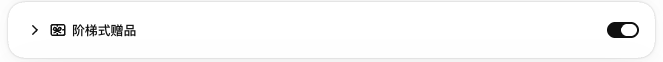

# 测试环境：赠品与捆绑商品双模块设计

日期：2026-11-25。状态：用户已确认模块顺序、并行生效及下述交互；用户补充按触发主商品分别计算额度、数量不足上限仍优惠，并明确赠品全部自动加入且在 app-block 不可取消、捆绑支持多选；用户已明确授权在独立测试目录开始实施，Tasks1–5 已完成本地实现与定向复审；Task6跨层验证与Task7最新交互修订已本地完成，最终完整分支独立审阅已完成，整合修复定向复审待执行；本轮不推送或远程发布。

**用户最新交互裁定（Task7已本地验证，取代此前冲突展示约定）：** 捆绑每规则固定1件，新旧配置统一为 `quantity=1`，商家和买家均无捆绑数量选择器，每规则只提供一个款式槽位；赠品配置数量仍可设置。每个合格主Product为捆绑规则贡献1件额度的既有独立额度池语义保持。赠品卡片不显示 Included/已包含/随单加入等重复状态文案；捆绑选择与取消使用原生 `input type="checkbox"`，保留单选/多选配置及锁卡点击解锁并选择。此裁定已在Task7完成本地实现与验证：共享规范化、SQLite/D1读写、公开与Function投影、Go执行、React和两代主题一致；实际本地截图与测试见 `docs/local/gifts-bundles-task7/`。全分支独立审阅已完成；整合修复的一次定向复审及真实平台验收仍未完成。

## 2026-11-25 商品数据来源修订（用户明确指定）

前台赠品/捆绑商品信息采用主题原生 `all_products`：OS3 使用 `all_products | get(handle)` 并通过 `get_variants()` 读取款式；OS2.1 使用 `get handle all_products` 及商品款式对象。以真实主题 `variant.available`、商品/款式字符串 ID 和当前页面币种价格为依据，不额外要求 Storefront Token。

活动发布时通过现有商家认证及发布锁，将已验证商品 ID/handle 引用同步到测试应用专用 shop metafield（`qb_test_offers.catalog_v1`），供模板在服务端渲染时读取。索引仅含引用、作用范围和配置版本摘要，不保存价格/库存快照。公开 Worker 仍核对活动、订阅、有效期、已发布状态及作用范围；模板目录只与匹配的活动和配置摘要结合，旧索引或读取失败不启用附加商品，主商品仍可用。该同步只实现代码，本轮不执行实际商家元字段写入或远程发布。

2.1 官方文档限制每页 `all_products` 最多20个不同 handle，且可能与主题其他代码共用额度；必须正确处理 `null` 和读取上限，不能显示虚构价格或可售状态。后台未保存草稿预览继续使用已有认证 Admin 商品/价格能力，不以库存推断款式可售性。本节取代旧设计/计划中的 Storefront 目录、价格代理及额外凭据依赖，其他已确认业务规则不变。

## 1. 实现范围与环境

目标是在现有多件优惠活动中增加两个可独立配置、同时生效的模块：免费赠品与优惠捆绑商品。

- 唯一可写项目：`/Users/SL/Desktop/多件折扣-测试环境/duojianzhekou-test`。
- Git：`https://github.com/TouchFish-Good/Kaching-Bundles-App-Upsells-Test.git`。
- 测试 Worker：`shopline-quantity-breaks-test`，域名 `app-test.vswwy.cn`。
- 测试 D1：`9fcea996-fdc3-4ade-a792-c8659e42800c`。
- 禁止修改正式项目源码、正式 Worker、正式数据库或正式扩展身份。不得覆盖测试 App Key、Secret、主题和 Function ID。
- 保持现有同 Product 累计、指定商品优先、订阅、排期、并发保存及发布确认行为。
- 不新增或修改 `:focus`、`:focus-visible` 及相关焦点伪类。
- 本轮开发授权不包含新的 Git 推送或远程发布；推送前说明具体 Git 地址、分支和本批文件，并取得本批授权。

本设计取代 [2026-11-24 设计](2026-11-24-gifts-bundles-design.md) 中的单一模块、模块位置、默认多选、解锁不勾选、单列默认、不提供轮播、按配置顺序决定异常单选及数量删减待定等内容。旧文档保留为历史分析与平台依据，不再作为这些产品决策的执行标准。

## 2. 已确认的页面与业务行为

编辑器面板顺序固定为：**设置 → 样式 → 赠品 → 捆绑商品**。

| 项目 | 赠品 | 捆绑商品 |
| --- | --- | --- |
| 优惠用途 | 达到条件后免费赠送 | 达到条件后优惠加购 |
| 金额设置 | 免费；计算投影使用固定价 0 | 每件固定减免、每件固定价格、百分比折扣；固定金额支持已有市场配置能力 |
| 独立配置 | 开关、商品/款式、数量、条件、标题/标签、样式 | 开关、商品/款式、数量、条件、标题/标签、样式 |
| 选择方式 | 所有符合条件的赠品自动加入；app-block 不提供取消 | 支持多选，买家可勾选或取消；保留此前默认单选并可切换多选的配置 |
| 同时生效 | 多个赠品可以同时达到条件并全部随主商品加购 | 可选择多个捆绑规则，同时与全部合格赠品生效 |

赠品不再使用此前讨论的单选/异常择优限制：已达条件的赠品规则累计生效，较高门槛不会替换较低门槛。捆绑的选择限制仅作用于捆绑模块；多选时各已选合法规则同时生效。赠品规则的配置数量可以大于1；按用户最新裁定，捆绑规则固定1件且单款式槽位，新旧配置均规范化为1。规则选择数和每规则件数是不同概念。

两个模块分别保存设置与样式，模块内沿用「设置｜样式」页签。关闭模块保留编辑配置，停止公开其可选项，不破坏另一个模块或主商品活动。

### 2.1 店铺模块默认标题与翻译

用户指定的默认文案须逐字保留：

| 店铺展示区域 | 默认英文标题 | 已实现翻译键 |
| --- | --- | --- |
| 赠品 | 🎁 Free gifts with your order | `widget.gifts.title` |
| 捆绑商品 | Frequently Bought Together | `widget.bundles.title` |

- 翻译页新增「赠品标题」「捆绑商品标题」两项，选择店铺已启用的显示语言后分别修改并保存；沿用现有按店铺和locale隔离的读取/保存、草稿保护和未保存提示。
- 默认英文标题为未配置文案的源文本；复用当前已标准化locale、已保存翻译和默认文案的回退链。后台应用界面语言不能替代店铺显示语言，也不因切换后台语言覆盖已保存翻译。
- `🎁`属于赠品标题文本，随该字段保存和编辑，不在渲染时额外重复拼接；捆绑默认标题不额外加表情。按文本渲染，不执行商家输入的HTML。
- 商家明确保存空标题时，只隐藏相应标题及装饰线；不关闭模块、不改变自动赠送或捆绑选择。字段不存在与显式空字符串需分别处理，不能用`value || default`覆盖主动清空。
- 编辑器预览、翻译预览、OS3和OS2.1 app-block使用同一标题来源。公共响应中的模块title若继续保留，只作为解析后的当前语言投影，不能另存同名文案覆盖翻译页。
- 翻译预览可展示并即时核对这两个区域标题，切换语言/设备不丢草稿；预览所需的展示场景不能反向启用真实活动模块或执行真实加购。
- 此处是店铺app-block的区域标题；后台配置面板仍使用本地化的「赠品」「捆绑商品」，不把前台英文默认标题替换到商家开关行上。

### 2.2 板块标题行与启用开关

按用户提供的图片还原标题行：白底、浅灰细边框、圆角和轻阴影；左侧依次为展开箭头、模块图标和标题，右端为紧凑的滑动开关。标题分别使用「赠品」「捆绑商品」，外观参考图片，不将图片中的名称自动替换为两个新模块的名称。

- 两个模块各有独立开关，控制该模块的 `enabled`；启用态参照图片为深色轨道/白色滑块，关闭态使用现有组件令牌，不额外设计另一套控件。
- 展开/收起与启用是两个独立操作。左侧箭头及标题区控制配置区展开，右侧开关只切换启用，不因事件冒泡同时折叠，也不因为展开了板块就启用优惠。
- 关闭时隐藏模块配置内容，保留商品、款式、条件、数量和设备样式草稿；再次打开时恢复。启用后可折叠配置，不影响已保存的启用状态。旧活动缺少模块时按关闭读取。
- 开关变更进入原活动草稿及 SaveBar，保存成功后再按已有发布确认机制更新公开配置；不增加独立保存按钮，不在点击开关时绕过活动保存立即发布。
- 开关具有模块名称、`role=switch`/`aria-checked` 和键盘操作；展开控件独立具有 `aria-expanded`/`aria-controls`。不把一个交互控件嵌套到另一个按钮内，不新增或修改焦点伪类。
- 商家可关闭整个赠品模块，与买家在 app-block 内不能取消已解锁赠品是两个不同层级；不能为了实现商家开关给店铺买家增加赠品取消入口。
- 实现后保存桌面/手机开启、关闭、启用但折叠及再次启用的本地截图，与本参考对照；本图片只作为视觉参考，不代表功能或本地页面已实现。

## 3. 解锁、选择与数量

- 触发条件继续支持指定档位及主商品数量 `gt / gte / eq`。
- 点击锁定卡片时，切换到能满足条件的最小实际配置档位。赠品模块随即自动纳入所有新达标赠品；捆绑模块自动勾选被点击规则，单选模式替换原捆绑选择、多选模式保留其他已选合法捆绑。
- 任何方式改变主商品档位或数量后，都重新计算全部赠品的资格；无需逐一点击，所有达标赠品自动纳入本次加购，app-block不允许手动取消。捆绑已选规则仍需分别符合条件；不因为赠品达标自动勾选未选择的捆绑商品。
- 数量下降时，移除本次待加购集合中不再合格的赠品与捆绑，更新明细与合计；不修改已经写入真实购物车的行。
- 自动勾选仍须尊重款式选择、可售性与价格读取；无法确定可售款式或金额时保留清晰的待选择/不可用状态，阻止提交未完成选择，不把未知价格当作免费。
- 切档、自动勾选与预计收费变化须有可见反馈；只有用户点击加购才写入真实购物车。
- 缺货或删除商品不能通过切档变成可售商品。
- 配置数量是每个合格主商品提供的优惠件数上限，不是最低领取数量。用户后续例子取代此前“必须凑齐”的表述；购物车内附加商品少于总上限时，仍优惠实际合法件数。
- 赠品与捆绑分别计算总上限和实际优惠件数。附加商品的同一实际件数只消费一份对应规则额度；跨行、跨款式、重复加购及新 context 不增加总上限。超出上限的部分按正常价格处理。
- 组件在一次选择中按配置数量提供款式槽位；真实购物车后来删减到更少时，Function按剩余合法件数与当前上限重算，不要求补足原数量。
- 主商品、赠品和捆绑商品是三种不同角色；同一实际购买件数不能既作为触发主商品又享受赠品或捆绑优惠。两种附加商品均不反向触发主商品门槛或彼此循环解锁。

赠品示例（每规则配置 1 件）：

| 主商品数量 | 赠品 A：≥2 件 | 赠品 B：≥3 件 | 点击一次加购的附加行 |
| --- | --- | --- | --- |
| 1 | 未解锁 | 未解锁 | 无赠品 |
| 2 | 自动加入 | 未解锁 | A |
| 3 | 自动加入 | 自动加入 | A、B |
| 4 | 自动加入 | 自动加入 | A、B |

按用户最新裁定，赠品卡片不显示Included、已包含或随单加入等重复状态文案，不提供可取消勾选框或删除按钮；不应因此禁用仍需操作的款式选择器。赠品多款式仍由买家选出合法款式，自动加入不等于替买家补造未知或缺货款式。

不可取消仅约束app-block内的待加购选择。它不代表Function能阻止买家在购物车删除赠品或自动重新添加；购物车删减后继续按真实数量与上限计算，保持第6节规则。

## 4. 捆绑单选/多选与赠品累计的结账判定

赠品：所有真实主商品满足条件且身份合法的规则分别计算额度和优惠，A、B同时解锁时可同时免费；不因为价格高低、门槛高低或配置排序只保留一个赠品。跨款式/跨行仍不得超过各规则自己的上限。

捆绑多选：所有已选且真实条件满足的捆绑规则分别享受优惠，各规则独立使用合法额度；不是从多个已选规则中只挑一个。

捆绑单选：保留此前确认的异常多规则处理，按折扣力度最大的一个进行优惠。计算解释供本版设计审阅：按当前可信价格、合法可优惠数量及适用市场计算实际可减免总金额，不单独比较百分比数字；金额相同再以displayOrder、稳定规则ID排序。不能依据客户端金额或context放大额度。

正常界面保留买家的捆绑选择，不主动更换为别的捆绑商品。赠品不与捆绑争抢选择名额；同一实际购物车件数仍不得在多个规则中重复优惠。

## 5. 布局

- 每个模块独立保存 PC 与移动配置。
- 默认网格：桌面一行三列，移动一行一列。均可设置一行一列、两列或三列。
- 另外提供单行轮播布局：只有一行卡片，可横向浏览，换页不清除选品；不自动播放，不无限复制卡片，不因显示下一屏读取所有市场价格。
- 轮播每屏的期望列数与设备列数配置一致；窄容器按实际宽度减少可见列数。只有卡片列表横向滚动，整个组件与页面不能溢出。
- 使用上一项/下一项按钮和触摸滑动；按钮具有本地化可访问名称及边界禁用状态。键盘聚焦到不可见卡片时滚动到可见范围，不修改现有焦点伪类。
- 区域标题跨列表显示；购物车明细、合计与加购按钮在两个模块之后，不放入轮播。
- 网格模式按容器宽度自动降列；继续采用旧稿 220px 卡片参考宽度、默认 12px 间距与单列 320px 转向建议，实际按参考及本地截图验收。
- 设备、列数、轮播位置或容器变化不改变已选规则与款式，不重新发放额度、不重复查询价格或提交加购。
- 保留参考图的卡片结构、标签位置、款式图片、规格选择器与金额样式；不另行重新设计原应用界面。

## 6. 按触发主商品分别计算额度

用户明确例子中的 A、B 是触发优惠的主商品，赠品和捆绑的数量上限由它们决定。采用每个合格主商品分别贡献额度，两个模块独立核算，不采用整个模块每购物车仅一份的建议。

计算定义：对同一活动和某个附加商品规则，先按 Product 分组计算真实主商品数量，各组分别判定触发条件。符合条件的不同 Product 各贡献一份该规则配置的件数额度。总优惠上限 = 合格主商品 Product 数 × 规则配置数量；实际优惠件数 = min(购物车中该规则的合法附加商品件数，总优惠上限)。

以每个合格主商品提供 1 件额度为例，赠品和捆绑都遵守下表：

| 合格主商品 | 附加商品实际件数 | 优惠件数 | 正常价格件数 |
| --- | --- | --- | --- |
| A、B | 1 | 1 | 0 |
| A、B | 2 | 2 | 0 |
| A、B | 3 | 2 | 1 |
| 仅 A | 1 | 1 | 0 |
| 仅 A | 2 | 1 | 1 |
| 无 | 任意 | 0 | 全部 |

主商品按 Product 区分：A 的多个款式或多条购物车行先累计判定门槛，不能重复贡献额度。A 买 3 件或 6 件，只要均满足同一规则条件，均只贡献一次该规则配置数量，不按购买件数倍增。A、B 的数量不合并满足单个主商品门槛。例：门槛为每个主商品至少 3 件，A=2、B=1 时没有合格主商品；A=3、B=3 时为两个。

同一主商品允许同时为赠品和捆绑各贡献一份，符合两个模块可同时生效的确认。主商品移除或不再满足条件时，相应减少两个模块中受影响规则的额度；剩余合法附加商品在新上限内仍可优惠，多余部分恢复正常价格，不由 Function 自动删除。

赠品对每个达标规则分别核算；捆绑多选对每个已选合法规则分别核算，不把不同附加商品的额度混成一个模块总池。捆绑单选时，名额限制仅作用于规则种类，不限制由多个主商品贡献的同一规则合法件数；异常择优仅适用于此模式。

## 7. 数据、接口与计算边界

活动 DTO 中分别保存 `gifts` 和 `bundles`，共用字段结构和校验引擎，独立开关、纳入策略、规则 ID 与样式；无字段的旧活动按关闭读取。布局增加 `mode: grid | carousel`，两端默认列数分别为 3 和 1。新增字段均是本应用协议，不表示 SHOPLINE 原生字段。赠品的纳入策略固定为全部达标自动加入，捆绑保留single/multiple；不将同一single开关用于控制两个模块。

对外协议、购物车属性和 Function 投影必须带模块身份。规则身份使用 `(campaignId, module, ruleId)`，行合并使用真实款式、角色、模块、规则和属性的复合身份；同款式的普通购买、赠品与捆绑行不得误合并。

保留旧公共活动协议，并以能力参数返回两个新模块。原生目录只消费当前已发布规则白名单与引用索引；公共授权校验店铺、活动revision、订阅及有效期，主题核对当前货币/语言/国家。不开放任意 Admin 商品代理，不泄漏凭据。延迟、429、目录不完整与单商品失败使用局部状态，不让主组件白屏。

Function 兼容现有 v1 活动，新投影同时包含两个模块；布局和文案不参与结账。先从真实主商品计算门槛，再校验模块/商品/款式身份、实际合法数量、按主商品计算的额度、赠品累计/捆绑多选或单选择优，最后统一输出合法数量与币种。赠品免费仍须真实价格和合格数量，不接受客户端优惠金额作为权威。

旧稿的分页、双主题、金额精度、币种统一、只读加购确认、身份校验、局部失败与已发布版本一致性要求继续适用。旧稿凡仅提 gifts 的协议与安全分析，在新实现中必须覆盖两种模块，不能只新增一个前端面板。

## 8. 平台核验与开发顺序

1. 完成更新后书面设计审阅，形成具体实施计划。
2. 为独立配置、按主商品发放额度、部分数量与超额、双模块同时生效、赠品全部自动加入且不可取消、捆绑多选/单选异常择优及 v1 兼容建立失败测试。
3. 实现模型、保存/复制/关闭、发布投影和 Function 核验；未确认支持的 Function 版本不得发布新投影。
4. 实现原生引用索引/公共描述、认证草稿预览及编辑器和翻译文案；不新增公开目录/价格服务。
5. 实现 OS3 / OS2.1 共用卡片、网格/轮播、自动勾选、复合购物车身份与主题通知。
6. 运行针对性测试、完整回归、构建和类型检查；逐页面保存参考与本地截图并更新进度。
7. 在测试店分别核验属性透传、ID映射、批量加购结果、市场价格及真实结账；未核验项目保持未验收状态。

平台能力仍有待实测边界：主题 all_products 元字段引用同步、渲染上限和本币价格单位、Function `sku` 与真实款式 ID 对照、带属性加购及回读、统一行级金额输出。不能以本地模拟替代这些证据。

## 9. 验收补充

- 面板严格位于样式之后，赠品在前、捆绑商品在后；两个模块同时配置、保存回读和关闭互不覆盖。
- 两板块标题行按参考还原，开关和展开分别响应；关闭/再启用保留规则与样式，操作一个开关不影响另一个；保存前不改变已发布店铺配置，键盘可操作且不增加焦点伪类。
- 两个默认前台标题逐字正确；翻译页按显示语言修改/保存/回读，店铺和locale不串值；精确locale/缺失翻译/默认文案回退一致。主动清空只隐藏标题，不关闭模块；emoji不重复，长标题在网格/轮播及手机上自然换行。
- 同一笔加购包含主商品、全部达标的免费赠品及多个已选收费捆绑；赠品不显示取消入口，捆绑可勾选/取消，明细和合计一致。
- 主商品数量1/2/3/4分别验证赠品A(≥2)、B(≥3)为无/A/A+B/A+B；直接切换档位、点击锁卡、预览恢复均重新计算全部赠品。4→2只保留A于待加购集合，不自动删除购物车历史行；不产生自动网络加购。
- 数量上限边界：无合格主商品、仅A、A和B；附加商品为0/1/2/3件；规则配置数量大于1；主商品跨款式拆行不多发，主商品减少则上限减少，跨context不重复额度。
- 择优边界：原价差异、百分比与固定金额比较、等额排序、实际数量较少的高减免候选、仅捆绑单选择优、捆绑多选与全部达标赠品累计。
- 网格和轮播分别核验桌面/移动默认、长标题、多规格、锁定、缺货、局部加载；轮播单行、不复制 ID、不丢选择、可用键盘/触摸浏览。
- 覆盖 1440px、390px、320px，以及 400/600/700px 独立容器；截图记录配置列数、实际列数和布局模式。
- 旧活动、无新模块时的零额外请求、授权、订阅、排期和指定商品优先规则保持回归验证。

当前Tasks1–5本地实现与定向复审完成，Task6已执行保存→公开→主题→Go真实codec链路及标题/旧协议验证；最新交互裁定Task7已完成本地实现与验证。正式725文件哈希/原Git状态、测试9身份哈希保持不变。参考与实际本地截图、套件历史与平台边界见[交付审计](../../audits/2026-11-25-gifts-bundles-local-integration.md)。仅有本地提交，未推送、部署、发布扩展或写真实商家购物车，不能标记最新交互、实店或整个应用验收完成。

## 最终独立审阅整合修复（2026-11-26）

本地补齐已确认行为：设置/样式页签；捆绑固定减免/固定价的既有认证市场金额配置及精确金额草稿校验；公共V1/V2跨已发布有效活动统一排除启用附件Product，React/主题主档位价格与Go保持原价；仅Product/Variant和市场上下文变化请求附件价格；轮播真实边界禁用、原生嵌套控件键盘安全、焦点可见与RTL/手动浏览。捆绑固定1件/原生checkbox、赠品数量/自动累计及一次POST/不确定事务规则保持。详见 [交付审计](../../audits/2026-11-25-gifts-bundles-local-integration.md) 与最终修复截图。全分支审阅已完成并提出上述修复；一次定向复审及真实平台验收仍待完成，不代表整应用完成。
